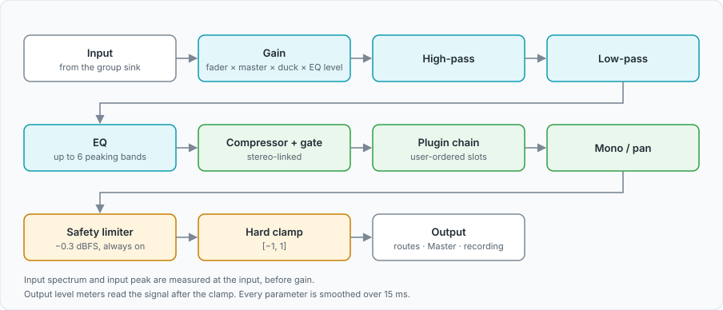

# Project Spec: MTX Panel — Per-Application Audio Mixer / Router

## 1. Purpose of this document

This is a build brief for an AI coding assistant (Claude Code) to scaffold and implement this project.
Read this document fully before writing any code. Ask clarifying questions only if something here is
genuinely ambiguous or contradictory — otherwise proceed with the decisions below as the source of truth.
Where a decision is marked `(OPEN)`, propose an approach and flag it explicitly rather than silently picking one.

## 2. Product summary

A per-application audio mixer and router. Audio streams from individual applications are grouped into
user-defined "groups." Each group gets its own processing chain (EQ, compression, gate) and its own fader.
The product is a system-level utility: audio routing keeps working whether or not any UI window is open.

**Long-term target platforms:** Linux, Windows, macOS.
**Actual build target for v1 (this repo): Linux only.** Do not write Windows/macOS-specific code paths in v1.
Linux was chosen first because PipeWire natively exposes per-application audio streams as routable graph
nodes, which removes the hardest technical problem (per-app capture) that the other two platforms don't
solve as cleanly.

## 3. Non-goals for v1

- No Windows (WASAPI loopback) or macOS (virtual driver / ScreenCaptureKit) support yet.
- No plugin/VST hosting.
- No cloud sync, accounts, or telemetry.
- No mobile companion app.
- Visual polish of the MTX Panel graphs can start rough — functional correctness of the DSP comes first.

## 4. Architecture

The system is split into a background daemon and one or more UI clients. The daemon is the single source
of truth; UI clients are thin and stateless beyond their own rendering.

- **Daemon**: Rust binary. Runs as a `systemd --user` unit, starts at login, independent of any UI process.
  Owns all PipeWire connections, creates one virtual PipeWire node per user-defined group, and runs all DSP
  (gain, EQ, compressor, gate) on the audio passing through each group node.
- **IPC**: D-Bus on the session bus (not system bus — this is per-user, not root). The daemon exposes a
  service (suggested name: `org.mtxpanel.Daemon`, object path `/org/mtxpanel/Daemon`) with methods for
  creating/editing groups, routing an app stream into a group, and setting DSP parameters, plus signals for
  state changes (so multiple UI clients stay in sync without polling).
- **Tauri UI**: the full application — Home, Inputs, MTX Panel, Faders, Settings (see Section 6). Rust
  backend (same language as the daemon, but a separate process/binary), web frontend for rendering.
- **Quickshell widget**: a QML component for quick access (faders, mute, group switching) living in the
  user's existing Quickshell-based shell config. Talks to the daemon over the same D-Bus interface using
  Qt's native D-Bus bindings. Do not duplicate any DSP or routing logic here — it is a thin client.

## 5. Tech stack

| Layer | Choice | Notes |
|---|---|---|
| Daemon language | Rust | Real-time-safe, no GC pauses in the audio callback |
| Audio routing | PipeWire, via `pipewire-rs` | Virtual group nodes, per-app stream linking |
| IPC | D-Bus, via `zbus` (Rust) / Qt D-Bus (QML) | Session bus, not system bus |
| EQ | Custom biquad filters (RBJ cookbook formulas) | Parametric bands, in-place per-sample processing |
| Compressor / gate | Custom (Rust), no external DSP library needed | Envelope follower + gain computer |
| Spectrum analysis | `rustfft` | Backs the live EQ graph / analyzer curve |
| System metrics | `sysinfo` crate | CPU/RAM for the Home tab |
| Full UI | Tauri (Rust backend + web frontend, Canvas/WebGL for graphs) | |
| Quick-access UI | Quickshell (QML) | |
| Packaging | Flatpak (primary), AppImage (secondary) | Flatpak handles the PipeWire dependency cleanly |

## 6. Real-time audio processing model

This section governs how `daemon/` must be structured. Get this right before anything else — it's the
part with zero tolerance for mistakes.

**Buffer model:** PipeWire invokes a registered callback once per buffer (~64–1024 frames; default to
something in the 256–512 range unless there's a reason to change it). All processing for a given callback
must complete well inside the real-time deadline implied by that buffer size and the sample rate.

**Per-group processing chain, applied in place on each buffer:**
1. Input buffer (samples arriving from the app streams linked into this group)
2. Gain stage (per-sample multiply, using a *smoothed* gain value — see below)
3. EQ — cascade of biquad filters, one per active band, applied per-sample
4. Compressor + gate — envelope follower drives gain reduction, applied per-sample
5. Output buffer (pushed to the group's PipeWire output node)

The chain as it is implemented today has more stages than this original
list (see [docs/dsp.md](docs/dsp.md)):

**Threading rules — non-negotiable:**
- No heap allocation inside the audio callback. Pre-allocate all buffers and filter state when a group is
  created or when the sample rate/buffer size changes, never per-callback.
- No mutexes or locks shared with non-real-time threads inside the callback. Use atomics for single scalar
  parameters (gain, a filter coefficient's target value) and a lock-free ring buffer (e.g. `rtrb` or
  similar) for batched parameter-change messages from the control/D-Bus thread.
- No blocking I/O, logging, or syscalls inside the callback.
- **Parameter smoothing is mandatory**, not optional: when a UI-driven parameter changes (fader move, EQ
  knob, threshold), the audio thread must ramp from the old value to the new target over a few
  milliseconds (linear or exponential interpolation, recomputed per sample) rather than snapping instantly.
  This applies to gain and EQ coefficients at minimum. Skipping this produces audible clicks/zipper noise
  and is a correctness bug, not a nice-to-have.

## 7. UI specification

### 7.1 Home tab
- Level/slider panel (per-group or master level meters)
- Live EQ panel showing a real-time analyzer graph (spectrum, backed by `rustfft`)
- Compression panel with a graph showing gain reduction over time
- System metrics: CPU, RAM, buffer size, buffer/xrun count
- Output/routing overview — a visual summary of which groups feed which outputs

### 7.2 Inputs tab
- Lists each detected application audio stream
- Shows which group (if any) each stream is currently routed into
- Allows creating groups and dragging/assigning app streams into them
- Processing (Section 6's chain) is applied per group, not per individual app stream

### 7.3 MTX Panel tab
- Visual reference: FabFilter Pro-R 2's UI language — clean, graph-driven, not skeuomorphic
- One side: gain / frequency / Q controls for the selected EQ band
- A High-pass / Low-pass filter section
- A Compression sub-tab with its controls (threshold, ratio, attack, release, makeup gain)
- A Gate sub-tab with its controls (threshold, attack, release, hold)
- The whole panel operates on whichever group is currently selected

### 7.4 Faders tab
- One fader per group/application, each independently adjustable
- A "global" configuration mode affecting multiple faders at once (OPEN: exact semantics of "globally
  configured" need clarification — e.g. does it mean linking faders together, or applying one gain offset
  to all of them? Confirm before implementing.)
- A master group fader that sits above/controls the overall output level

### 7.5 Settings tab
- Central place to view and change all application settings (audio device selection, buffer size,
  autostart behavior, Quickshell widget toggle, theme, etc. — exact settings list is OPEN and can be
  filled in incrementally as features are built)

## 8. D-Bus interface (starting proposal — refine as needed)

Service: `org.mtxpanel.Daemon`, object path `/org/mtxpanel/Daemon`.

Suggested methods (adjust naming/signatures to match idiomatic `zbus` conventions):
- `CreateGroup(name: string) -> group_id`
- `DeleteGroup(group_id)`
- `RouteStreamToGroup(stream_id, group_id)`
- `SetGain(group_id, value: f32)`
- `SetEQBand(group_id, band_index, freq: f32, gain: f32, q: f32)`
- `SetCompressor(group_id, threshold, ratio, attack, release, makeup_gain)`
- `SetGate(group_id, threshold, attack, release, hold)`
- `ListGroups() -> [GroupInfo]`
- `ListStreams() -> [StreamInfo]`

Suggested signals (so multiple UI clients stay in sync):
- `GroupChanged(group_id)`
- `StreamListChanged()`
- `MetricsUpdated(cpu, ram, buffer_size, xrun_count)`

## 9. Suggested build order

1. **Daemon skeleton**: connect to PipeWire, enumerate existing app streams, log them. No DSP yet.
2. **Group creation + routing**: create a virtual group node, link an app stream into it, pass audio
   through unmodified (identity pass-through). Verify no glitches/xruns under normal load.
3. **Gain stage** with parameter smoothing. This is the simplest place to prove the smoothing approach
   works before building EQ/compressor on top of it.
4. **D-Bus interface**: expose group creation, routing, and gain control over D-Bus. Test with `busctl` or
   a minimal script before building any UI against it.
5. **EQ (biquad cascade)**: implement one band, verify audibly and (ideally) with a test signal / measured
   frequency response, then extend to multiple bands.
6. **Compressor and gate**.
7. **Tauri UI**: start with Faders + Inputs tabs (the simplest, most directly tied to what's already
   working), then Home, then the full MTX Panel.
8. **Quickshell widget**: once the D-Bus interface is stable, build the quick-access widget against it.
9. **Packaging**: Flatpak manifest, verify the PipeWire dependency and permissions are correctly declared.

## 10. Non-functional requirements

- No audible glitches (xruns) under normal desktop use (a handful of apps producing audio simultaneously).
- Daemon must survive UI process crashes/restarts without losing routing state or audio.
- Daemon should recover gracefully if PipeWire itself restarts (a known real-world event on some setups).
- All user-facing group/routing configuration should persist across daemon restarts (OPEN: decide on a
  config file location/format, e.g. TOML under `~/.config/mtxpanel/`).

## 11. Explicit open questions for whoever picks this up

- Exact semantics of "global fader configuration" in the Faders tab (Section 7.4).
- Full list of Settings tab options (Section 7.5) — start minimal, grow as needed.
- Config persistence format and location (Section 10).
- Default buffer size / sample rate handling when different apps request different rates.
