<p align="center">
  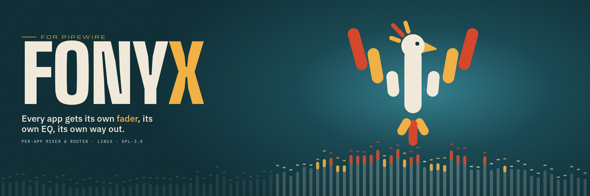
</p>

<p align="center">
  <b>A per-application audio mixer and router for Linux, built on PipeWire.</b><br>
  <sub>Every app gets its own fader, its own EQ, its own way out.</sub>
</p>

<p align="center">
  <a href="docs/packaging.md"></a>
  <a href="https://github.com/ArdenDiago/Fonyx/actions/workflows/ci.yml"></a>
  
  
  <a href="LICENSE"></a>
</p>

<p align="center">
  <a href="#-quick-start">Quick start</a> ·
  <a href="#-a-look-inside">Screenshots</a> ·
  <a href="#-what-it-does">Features</a> ·
  <a href="#-how-it-works">How it works</a> ·
  <a href="docs/index.md">Docs</a> ·
  <a href="docs/roadmap.md">Roadmap</a>
</p>

---

Spotify in your headphones, Discord on the speakers, the game on both with
its own EQ, and a browser tab that ducks everything when it talks. Fonyx
puts each application's audio into a **group**: a real PipeWire bus with its
own fader, its own processing chain and as many outputs as you like.

A background daemon owns the audio graph and does all the processing, so
nothing stops when you close the window. The desktop app, the `fonyx` CLI
and the Quickshell surfaces are all thin clients over one D-Bus interface.

## ⚡ Quick start

**From source**, as systemd user services with a watchdog (no root):

```bash
git clone https://github.com/ArdenDiago/Fonyx.git && cd Fonyx
sh packaging/install-user.sh
```

**As an AppImage**, to try it without installing anything: download
[`Fonyx-x86_64.AppImage`](https://github.com/ArdenDiago/Fonyx/releases/latest/download/Fonyx-x86_64.AppImage),
then:

```bash
chmod +x Fonyx-x86_64.AppImage
./Fonyx-x86_64.AppImage
```

It starts its own audio engine and stops it when you close the window. It
needs PipeWire with WirePlumber on a recent distribution (Debian 12,
Ubuntu 23.04, Fedora 37, Arch, or newer).

**From the Snap Store: coming soon.** A one-line `snap install fonyx` is on
its way. Until then, use the AppImage or build from source.

Then drive it from the window, or from a terminal:

```bash
fonyx group create Music
fonyx input move spotify Music
fonyx fader set Music -6dB
fonyx system status
```

<details>
<summary><b>Requirements and building by hand</b></summary>

<br>

- A Linux session running PipeWire, with WirePlumber's `wpctl`
- Rust with Cargo, `clang` (for `pipewire-rs` bindings) and
  `webkit2gtk-4.1` (Tauri's webview)
- Optional: `quickshell` for the shell surfaces, Node.js for the UI tests

```bash
pacman -S clang webkit2gtk-4.1     # Arch Linux

cargo build --workspace            # daemon, UI and CLI
cargo test --workspace             # unit tests, no PipeWire needed
cargo run -p fonyx-daemon          # RUST_LOG=info for stream and group logging
cargo run -p fonyx-ui              # in a second terminal
```

The UI connects to the daemon at startup, so start the daemon first.
Developed on Arch Linux; CI builds and tests on Ubuntu 24.04. Install
details are in [Packaging](docs/packaging.md), every command in
[Command line](docs/cli.md).

</details>

## 🎛 A look inside

<table>
  <tr>
    <td width="50%">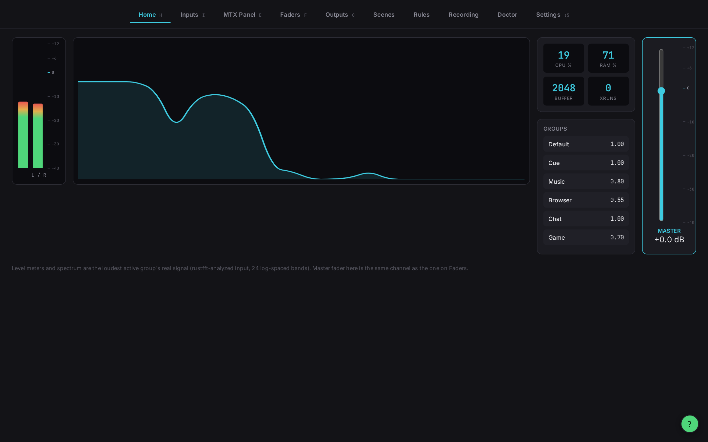<br><b>Home</b>: meters and spectrum of the loudest group, daemon metrics, the master fader.</td>
    <td width="50%">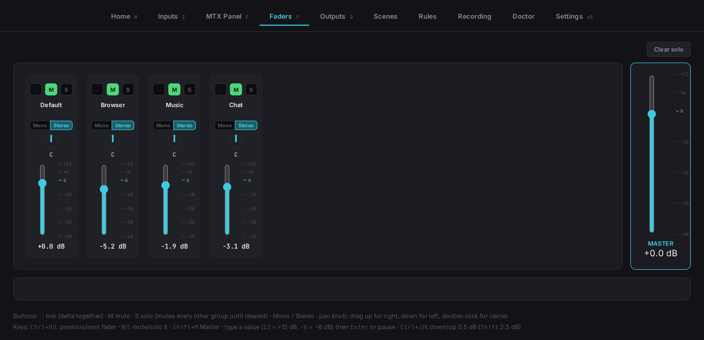<br><b>Faders</b>: a strip per group with mute, solo, link, mono/stereo and pan.</td>
  </tr>
  <tr>
    <td>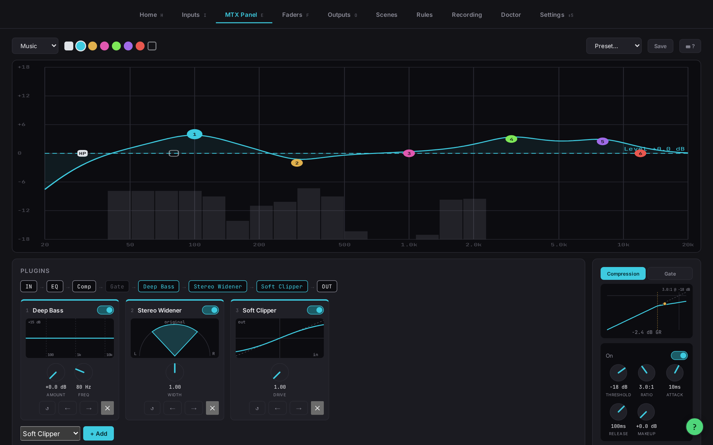<br><b>MTX Panel</b>: the EQ curve over the live spectrum, plugins, compressor and gate.</td>
    <td>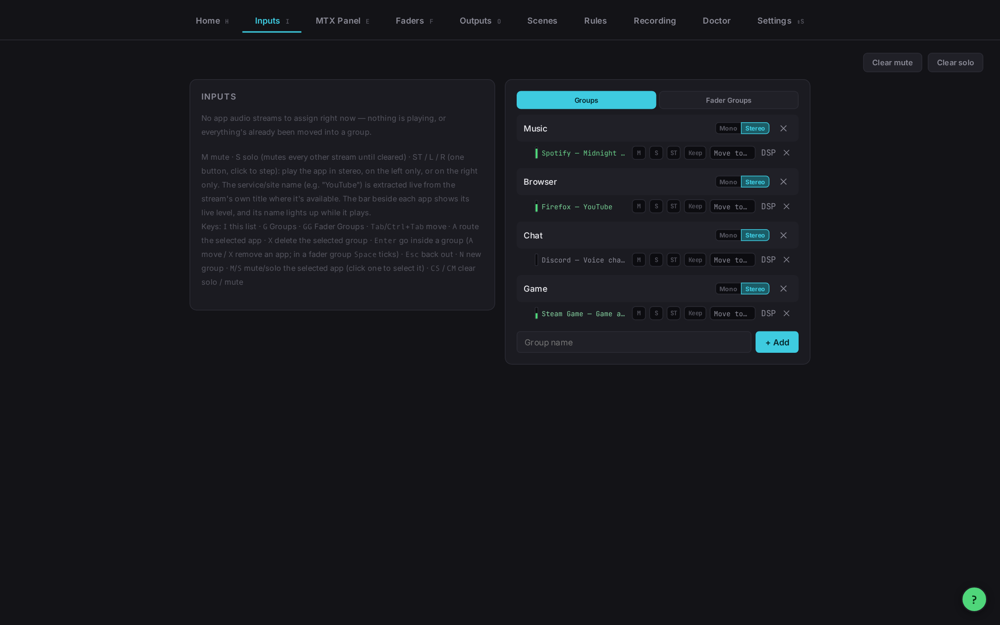<br><b>Inputs</b>: every app's stream, and the group it plays through.</td>
  </tr>
  <tr>
    <td>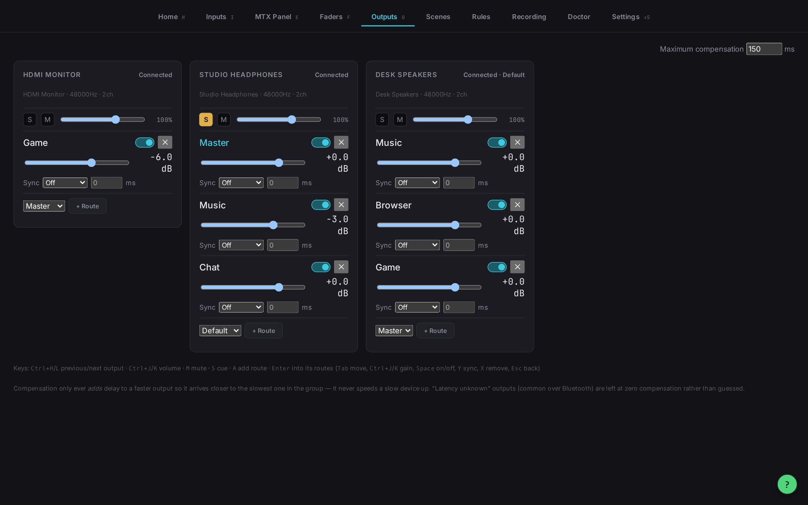<br><b>Outputs</b>: each device, the groups routed to it, per-route gain, sync and delay.</td>
    <td>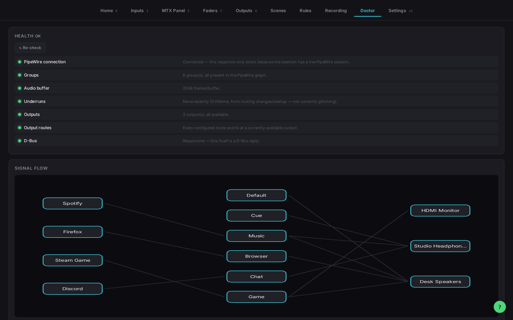<br><b>Doctor</b>: health checks and the signal flow from apps to speakers.</td>
  </tr>
  <tr>
    <td colspan="2">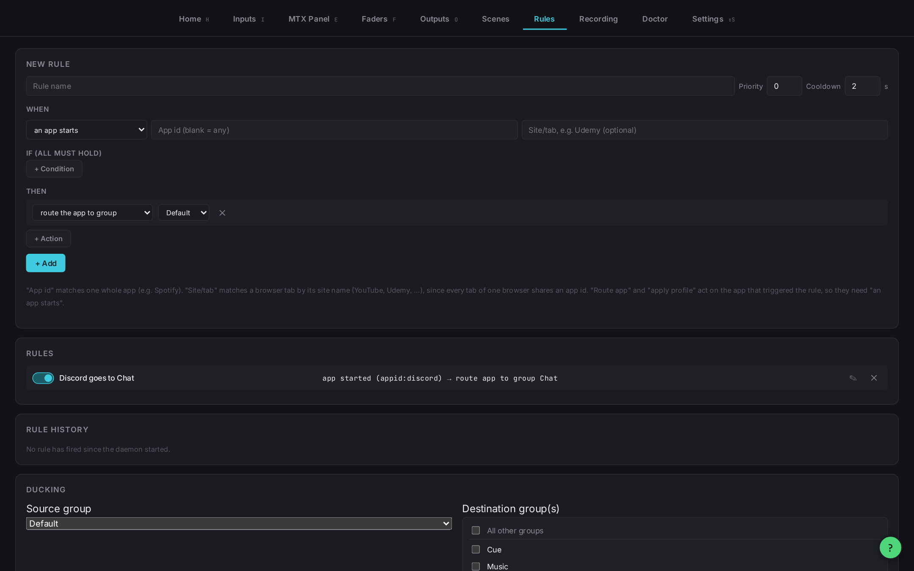<br><b>Rules</b>: when something happens, do something. Plus ducking.</td>
  </tr>
</table>

<sub>Captured in a throwaway PipeWire session with four demo streams playing.</sub>

## 🔥 What it does

<table>
  <tr>
    <td valign="top" width="50%">

**Routing**
- Every app lands in a protected **Default** group, so nothing bypasses the mixer
- Send a group to several outputs at once, each with its own gain, switch and delay compensation
- **Master** bus: the sum of every group, routable on its own
- **Cue** bus: solo an app into your headphones while the rest ducks there
- **Own DSP**: give one app its own group, cloned from where it was
- Per-stream left / right / stereo isolate

  </td>
  <td valign="top" width="50%">

**Sound, per group**
- Gain under a master fader
- High-pass and low-pass filters
- Six-band parametric EQ with a whole-curve level offset
- Compressor and gate
- Plugins: Soft Clipper, Stereo Widener, Deep Bass, Mids
- Mono/stereo, pan, and an always-on safety limiter
- Every parameter smoothed. Nothing clicks, nothing snaps

  </td>
  </tr>
  <tr>
    <td valign="top">

**Automation**
- **Scenes**: capture and recall the whole mixer
- **Profiles**: an app returns to its group and volume when it restarts
- **Rules**: react to app start/stop, device plug/unplug, scenes, resume from sleep
- **Ducking**: lower chosen groups while another one is active

  </td>
  <td valign="top">

**Tools**
- Record a group's processed signal to WAV or FLAC
- Doctor: health checks for groups, buffer, underruns and outputs
- Signal-flow graph from streams through groups to outputs
- Live meters, spectrum, gain reduction, CPU and RAM

  </td>
  </tr>
  <tr>
    <td valign="top">

**Three ways in**
- **Desktop app** (Tauri): ten tabs, a draggable EQ graph, a live compressor curve, keyboard control, light and dark themes
- **`fonyx` CLI**: every mixer function by name, prefix or alias, with `--json` for scripts
- **Quickshell**: a standalone app, a status-bar fader widget and a keybind popup

  </td>
  <td valign="top">

**Built for Linux**
- PipeWire for every byte of audio
- One D-Bus session service: `org.fonyx.Daemon`
- systemd user services with a watchdog
- Config in plain TOML at `~/.config/fonyx/`
- Close or crash any window; the audio keeps playing

  </td>
  </tr>
</table>

## 🧭 How it works

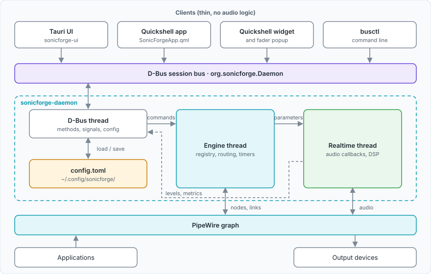

Each group is a virtual PipeWire sink. Apps are linked into it port by port,
the DSP chain runs in the sink's realtime callback, and the result crosses a
lock-free ring buffer to one playback stream per output.

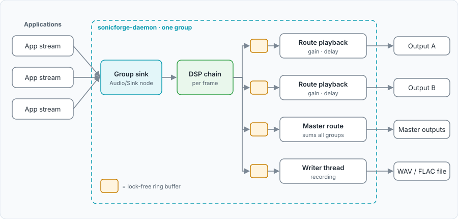

| Area | Technology |
|---|---|
| Daemon and DSP | Rust, PipeWire via `pipewire-rs` |
| IPC | D-Bus session bus via `zbus` |
| Desktop app | Tauri 2, one HTML file, no framework, no build step |
| Shell integration | Quickshell (QML) through `busctl` |
| Packaging | Snap Store, user install script, systemd user units |
| Tests | Rust unit tests; Playwright endpoint and UI tests against a real daemon |

<details>
<summary><b>Module map</b>: every source area and how they connect</summary>

<br>

Solid arrows are calls or data flow at run time; dotted arrows show what the
config file stores.

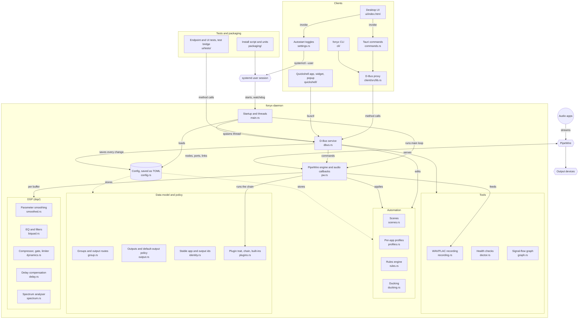

</details>

<details>
<summary><b>Repository layout</b></summary>

```text
.
├── daemon/            # fonyx-daemon: PipeWire engine, DSP, D-Bus service
│   └── src/dsp/       # smoothing, biquads, dynamics, delay, spectrum
├── client/            # fonyx-client: the D-Bus proxy the UI and CLI share
├── cli/               # fonyx: the command-line client
├── ui/
│   ├── index.html     # the whole frontend
│   ├── src-tauri/     # fonyx-ui: Tauri backend, a thin D-Bus client
│   └── tests/         # endpoint tests, UI smoke tests, isolated test runner
├── quickshell/        # Quickshell app, widget and popup
├── packaging/         # install script, systemd units, branding
├── snap/              # Snap Store package
├── site/              # the project website
├── docs/              # project documentation
└── .github/workflows/ # CI and the snap deploy
```

</details>

## 🧪 Tested against the real thing

Nothing is mocked. Endpoint tests call every command the frontend can use
against a **real daemon**, Playwright drives the real `ui/index.html`, and
`cli/tests/smoke.sh` runs every CLI command. A test that creates a group
creates a real PipeWire node, inside a throwaway PipeWire and D-Bus session
that never touches your own audio:

```bash
sh ui/tests/run-isolated.sh
```

CI runs all of it on every pull request. Work lands on `staging`; merging
`staging` into `main` triggers a snap build on the Snap Store. More in
[Testing](docs/testing.md).

## 🗺 Status

Fonyx is young: the Snap Store release is coming soon, and it has only run on
Arch Linux (development) and Ubuntu 24.04 (CI).

- [x] Daemon, groups, Default / Cue / Master buses, full DSP chain, plugins
- [x] Multiple outputs per group with delay compensation
- [x] Scenes, profiles, rules, ducking, recording, Doctor
- [x] Desktop app, CLI, Quickshell surfaces, systemd services
- [ ] Snap Store release (coming soon)
- [ ] Survive a PipeWire restart while the daemon runs
- [ ] Tests that check what the audio *sounds* like, not just stored state
- [ ] Bring the Quickshell app level with the desktop app

The full list is in the [Roadmap](docs/roadmap.md).

<details>
<summary><b>Formerly MTX Panel, then SonicForge</b></summary>

<br>

Everything now uses `fonyx` in lower case (`fonyx-daemon`,
`org.fonyx.Daemon`, `~/.config/fonyx/`); only the EQ tab is still titled
"MTX Panel". A config left at `~/.config/sonicforge/` or `~/.config/mtxpanel/`
is moved over the first time the daemon starts.

</details>

## 📚 Documentation

| | |
|---|---|
| [Architecture](docs/architecture.md) | Processes, threads, data flow, state |
| [Audio engine](docs/audio-engine.md) | PipeWire nodes, routing, ring buffer, outputs |
| [DSP](docs/dsp.md) | The processing chain, stage by stage |
| [D-Bus](docs/dbus.md) | Service, methods, signals |
| [Command line](docs/cli.md) | Commands, naming, aliases, scripting |
| [UI](docs/ui.md) | Tauri app, tabs, client-side state |
| [Quickshell](docs/quickshell.md) | The three Quickshell surfaces |
| [Testing](docs/testing.md) | Test suites and engineering verification |
| [Packaging](docs/packaging.md) | Snap, install script, systemd units |
| [Design decisions](docs/decisions.md) | What was chosen and why |
| [Development](docs/development.md) | Working on the code |
| [Roadmap](docs/roadmap.md) | Done, open and possible work |

## Contributors

<table>
  <tr>
    <td align="center" width="160"><a href="https://github.com/ArdenDiago"><br><b>Arden Diago</b></a><br><sub>Author and maintainer</sub></td>
    <td align="center" width="160"><a href="https://claude.com/claude-code"><br><b>Claude</b></a><br><sub>Pair programmer via Claude Code, co-author on its commits</sub></td>
  </tr>
</table>

---

<p align="center">
  <br>
  <sub>GPL-3.0-or-later · see <a href="LICENSE">LICENSE</a></sub>
</p>
