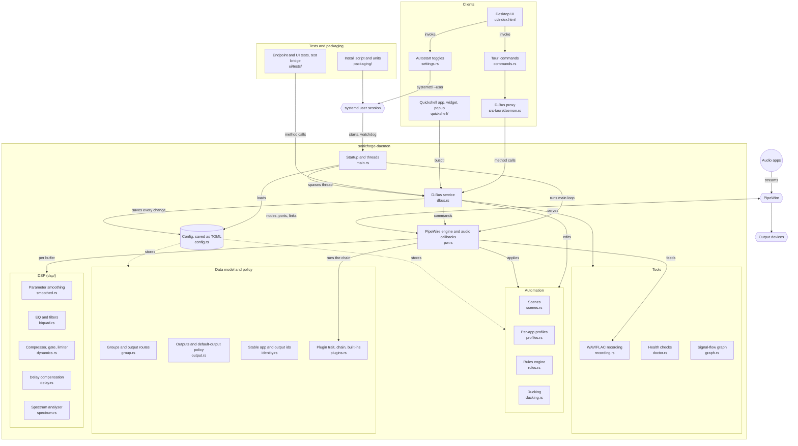

# SonicForge

> Per-application audio mixer and router for Linux, built on PipeWire.

[Documentation](docs/index.md) ·
[Architecture](docs/architecture.md) ·
[Development](docs/development.md) ·
[Testing](docs/testing.md) ·
[Roadmap](docs/roadmap.md) ·
[Source](https://github.com/ArdenDiago/SonicForge)

## Overview

SonicForge puts each application's audio into a user-defined **group**. Every
group has its own fader and its own processing chain (EQ, filters,
compressor, gate, plugins, pan), and can be sent to one or more output
devices.

A background daemon owns the PipeWire graph and does all the processing, so
routing keeps working whether or not a window is open. The desktop UI and
the Quickshell surfaces are thin clients that talk to the daemon over D-Bus.


The project was previously named MTX Panel. Everything now uses the new
name in lower case (`sonicforge-daemon`, `org.sonicforge.Daemon`,
`~/.config/sonicforge/`); only the EQ tab is still titled "MTX Panel". A
config directory left at `~/.config/mtxpanel/` is moved over the first time
the daemon starts.

The project targets Linux only. It is at version 0.1.0 with no tagged
release and no published packages; you build it from source.

## Screenshots

Taken from a throwaway PipeWire session with four demo streams playing.

**Home** — level meters and spectrum of the loudest active group, daemon
metrics, group list and the master fader.


**Faders** — one strip per group with mute, solo, link, mono/stereo and pan.


**Inputs** — application streams on the left, the groups they are routed
into on the right.


## Features

### Audio routing

- Discovers application audio streams and shows which ones are playing
- Routes streams into groups; every stream lands in a protected "Default"
  group until moved
- Removes the stream's direct hardware link when routing it, so the signal
  is never heard twice
- Sends a group to several outputs at once, each with its own gain, enable
  switch and delay compensation
- Master bus: the sum of all groups, routable to its own outputs
- Cue bus: solo an app or group onto designated cue outputs (headphones),
  with the rest of the mix ducked there
- Per-app "Own DSP": moves an app into its own group that starts as a copy
  of the one it was in
- Per-stream left / right / stereo isolate

### DSP (per group)

- Gain, with a master fader on top
- High-pass and low-pass filters
- Six-band parametric EQ with a whole-curve level offset
- Compressor and gate
- Plugin chain: Soft Clipper, Stereo Widener, Deep Bass, Mids
- Mono / stereo switch and pan
- Always-on safety limiter
- Every parameter is smoothed; nothing snaps

### Automation

- Scenes: capture and recall the whole mixer state
- Per-app profiles: an app returns to its group and volume when it restarts
- Rules: trigger on app start/stop, device connect/disconnect, scene
  activation or resume from sleep
- Ducking: lower chosen groups while another group is active

### Tools

- Recording of a group's processed signal to WAV (16-bit or 32-bit float)
  or FLAC (24-bit)
- Doctor: health checks for groups, buffer, underruns and outputs
- Signal-flow graph of streams, groups and outputs
- Live level meters, spectrum, gain-reduction meters, CPU/RAM

### Command line

- `sonicforge`: every mixer function from a terminal or a script, with
  names, prefixes or your own aliases instead of ids, and `--json` output
- Start, stop and restart the daemon and UI services, and read their status

### Desktop UI

- Tauri application with ten tabs: Home, Inputs, MTX Panel, Faders,
  Outputs, Scenes, Rules, Recording, Doctor, Settings
- Interactive EQ graph (drag a node for frequency and gain, scroll for Q)
- Compressor transfer curve with a live position marker
- Faders with mute, solo, link, fader groups, pan and mono/stereo
- Keyboard control across the app
- Light and dark themes

### Linux integration

- PipeWire for all audio I/O
- D-Bus session service (`org.sonicforge.Daemon`)
- systemd user services with a watchdog
- Quickshell: a full standalone app, a fader widget for a status bar, and a
  fader popup for a compositor keybind

## Architecture


Each group is a virtual PipeWire sink. Application streams are linked into
it port by port, the DSP chain runs in the sink's process callback, and the
result is handed through a lock-free ring buffer to one playback stream per
output route.

### Module map

Every source area and how they connect. Solid arrows are calls or data flow
at run time; the dotted arrows show what the config file stores.



See [Architecture](docs/architecture.md) for the full picture.

## Technology stack

| Area | Technology |
|---|---|
| Daemon and DSP | Rust |
| Audio server | PipeWire, via `pipewire-rs` |
| IPC | D-Bus session bus, via `zbus` |
| Desktop UI | Tauri 2 (Rust backend, WebKitGTK webview) |
| Frontend | A single HTML file with plain CSS and JavaScript, no framework |
| Shell integration | Quickshell (QML), calling the daemon through `busctl` |
| Config | TOML at `~/.config/sonicforge/config.toml` |
| Service management | systemd user units |
| Packaging | User install script |
| Tests | Rust unit tests; Playwright endpoint and UI tests against a real daemon |
| CI | GitHub Actions |

## Repository structure

```text
.
├── daemon/            # sonicforge-daemon: PipeWire engine, DSP, D-Bus service
│   └── src/dsp/       # smoothing, biquads, dynamics, delay, spectrum
├── client/            # sonicforge-client: the D-Bus proxy the UI and CLI share
├── cli/               # sonicforge: the command-line client
├── ui/
│   ├── index.html     # the whole frontend
│   ├── src-tauri/     # sonicforge-ui: Tauri backend, a thin D-Bus client
│   └── tests/         # endpoint tests, UI smoke tests, isolated test runner
├── quickshell/        # Quickshell app, widget and popup
├── packaging/
│   ├── systemd/       # user units
│   └── install-user.sh
├── .github/workflows/ # CI
├── docs/              # project documentation
├── PROJECT_SPEC.md    # the original build brief
└── README.md
```

## Installation

There is no packaged release. Build from source.

### Requirements

- A Linux session running PipeWire, with WirePlumber's `wpctl` available
  (the daemon uses it for stream and output volume and mute)
- A Rust toolchain with Cargo
- `clang` (needed by `pipewire-rs` to generate bindings)
- `webkit2gtk-4.1` (Tauri's webview)
- Optional: `quickshell` for the Quickshell surfaces, Node.js for the UI
  tests

On Arch Linux the two system packages are:

```bash
pacman -S clang webkit2gtk-4.1
```

The project is developed and run on Arch Linux. CI builds it and runs the
tests on Ubuntu 24.04. Other distributions have not been tried.

### Build

```bash
git clone https://github.com/ArdenDiago/SonicForge.git
cd SonicForge
cargo build --workspace          # daemon, UI and CLI, debug build
```

### Test

```bash
cargo test --workspace             # daemon and CLI unit tests
```

### Run

```bash
cargo run -p sonicforge-daemon     # RUST_LOG=info for stream and group logging
cargo run -p sonicforge-ui         # in a second terminal
```

The UI needs the daemon to be running; it connects to it over the session
bus at startup. The daemon can also be driven without any UI, from the
command line:

```bash
cargo run -p sonicforge-cli -- group create Music   # `sonicforge group create Music` once installed
sonicforge input move firefox Music
sonicforge fader set Music -6dB
sonicforge system status
```

See [Command line](docs/cli.md) for every command.

### Install

```bash
sh packaging/install-user.sh
```

This builds release binaries, installs them (the daemon, the UI and the
`sonicforge` CLI) to `~/.local/bin`, installs the systemd user units, and
starts the daemon and UI as user services. It needs
no root. Details are in [Packaging](docs/packaging.md).

## Testing

The daemon has unit tests for its DSP and its pure logic (routing policy,
rules, scenes, identity, delay compensation, health checks).

Endpoint tests call every command the frontend can use against a **real
daemon**, and Playwright smoke tests drive the real `ui/index.html` in a
headless browser. Neither is mocked: a test that creates a group creates a
real PipeWire node. They run inside a throwaway PipeWire and D-Bus session,
so they never touch your own audio:

```bash
sh ui/tests/run-isolated.sh
```

The `sonicforge` CLI is checked the same way: `cli/tests/smoke.sh` runs
every command against a real daemon in that throwaway session.

CI runs the build and all of these on every push to `staging` and every
pull request. Work lands on `staging` first; `main` is protected and only
accepts a passing pull request from `staging`.

Much of the engine was also verified by hand against real audio, and those
findings are written up as engineering notes.

See [Testing](docs/testing.md).

## Current status

### Implemented

- [x] PipeWire daemon with stream discovery and group routing
- [x] Default group, Cue group, Master bus
- [x] Gain, HPF/LPF, six-band EQ, compressor, gate, safety limiter
- [x] Parameter smoothing
- [x] Plugin chain with four built-in plugins
- [x] Pan, mono/stereo, per-stream left/right isolate
- [x] Multiple outputs per group with delay compensation
- [x] Scenes, per-app profiles, rules, ducking
- [x] Recording to WAV and FLAC
- [x] Doctor health checks and signal-flow graph
- [x] D-Bus interface
- [x] Tauri UI, all ten tabs
- [x] `sonicforge` command-line client
- [x] Quickshell app, widget and popup
- [x] systemd user units and install script

### Remaining or unverified

- [ ] No handling for a PipeWire restart while the daemon is running
- [ ] Tests check stored state, not what the audio sounds like
- [ ] Only run on Arch Linux (development) and Ubuntu 24.04 (CI)
- [ ] The Quickshell app lags the Tauri UI on recent features

The full list is in the [Roadmap](docs/roadmap.md).

## Documentation

| Document | Contents |
|---|---|
| [Architecture](docs/architecture.md) | Processes, threads, data flow, state |
| [Audio engine](docs/audio-engine.md) | PipeWire nodes, routing, ring buffer, outputs |
| [DSP](docs/dsp.md) | The processing chain, stage by stage |
| [D-Bus](docs/dbus.md) | Service, methods, signals |
| [Command line](docs/cli.md) | The `sonicforge` CLI: commands, naming, aliases, scripting |
| [UI](docs/ui.md) | Tauri app, tabs, client-side state |
| [Quickshell](docs/quickshell.md) | The three Quickshell surfaces |
| [Testing](docs/testing.md) | Test suites and engineering verification |
| [Packaging](docs/packaging.md) | Install script and systemd units |
| [Design decisions](docs/decisions.md) | What was chosen and why |
| [Development](docs/development.md) | Working on the code |
| [Roadmap](docs/roadmap.md) | Done, open and possible work |

## Contributors

- [Arden Diago](https://github.com/ArdenDiago) — author and maintainer
- [Claude](https://github.com/claude), Anthropic's AI model, through
  [Claude Code](https://claude.com/claude-code) — pair programmer on the
  daemon, UI, tests and documentation, credited as co-author on the commits
  it worked on

## License

GPL-3.0-or-later. See [LICENSE](LICENSE).
