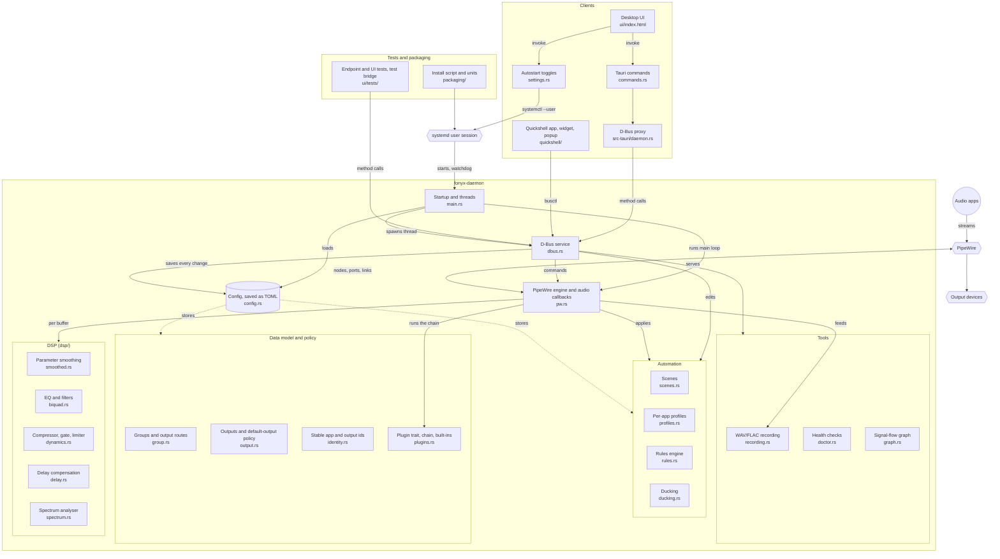

# Architecture

Fonyx is a background daemon plus thin clients. The daemon is the single
source of truth: it owns the PipeWire graph, runs all DSP, and persists all
configuration. Clients render state and send commands; they contain no audio
or routing logic.

## Components


| Component | Binary / entry point | Role |
|---|---|---|
| Daemon | `fonyx-daemon` (`daemon/`) | PipeWire engine, DSP, D-Bus service, config |
| Desktop UI | `fonyx-ui` (`ui/src-tauri/`, `ui/index.html`) | Full application |
| Quickshell app | `quickshell/FonyxApp.qml` | Standalone rebuild of the UI in QML |
| Quickshell widget | `quickshell/FonyxWidget.qml` | Fader panel for a status bar |
| Quickshell popup | `quickshell/FonyxPopup.qml` | The widget in its own window |

The daemon and the UI are separate processes in one Cargo workspace. Closing
or crashing a UI does not affect audio.

## Core concepts

**Stream.** One application's audio output node in PipeWire. Streams are
identified live by PipeWire node id and persistently by a stable app
identity (`application.id`, else `application.name`, else `node.name`).

**Group.** A user-defined bus. Each group is a virtual PipeWire sink with its
own DSP chain and fader. A stream belongs to exactly one group at a time.

**Default group.** A protected group that always exists. Every newly
detected stream is routed into it unless a profile, rule, scene or earlier
assignment says otherwise, so no application audio bypasses the mixer.

**Cue group.** A permanent group for soloing. Its outputs are the devices
marked as cue outputs, and it is never summed into Master. While it is
audible, everything else on the cue outputs is lowered to the cue duck
level.

**Output route.** A group's connection to one output device, with its own
gain, enable switch and delay. A group with no explicit routes uses a single
implicit default route.

**Master bus.** The sum of every group's processed signal (except Cue),
sent to its own list of output routes. It plays nowhere until a route is
added.

## Daemon threads

| Thread | Runs | Touches |
|---|---|---|
| Engine (main) | PipeWire main loop: registry events, `Command` handling, ducking and watchdog timers, signal handlers | `Engine` state |
| Realtime | Every stream's `process` callback (streams use `RT_PROCESS`) | DSP state, ring buffers |
| D-Bus | `zbus` blocking server | `Config`, shared read-only views |
| Metrics | `sysinfo` refresh once a second | CPU/RAM atomics |
| Resume watcher | logind `PrepareForSleep` on the system bus | sends `SystemResume` |
| Recording writers | One per active recording | file I/O |

The `process` callbacks run on PipeWire's realtime thread, not on the engine
thread. State shared between them follows two rules:

- Per-sample parameters (gain, EQ values, pan, thresholds) are lock-free
  atomics wrapped in `Smoothed`.
- Structural collections that change only on control events (the route
  fan-out list, the plugin chain, recording taps, a route's delay line) sit
  behind `Arc<Mutex<_>>`, held briefly.

An earlier design assumed everything shared one thread and used
`Rc<RefCell<_>>`. That produced a real `already borrowed` panic under audio
load and was replaced. See [Design decisions](decisions.md).

## Control flow

A change made in a client follows one path:

```text
Client
  → D-Bus method on org.fonyx.Daemon
    → D-Bus thread updates Config and saves config.toml
    → D-Bus thread sends a Command over a PipeWire channel
      → Engine thread applies it to the live graph or sets a parameter target
        → Realtime thread ramps to the new value
    → D-Bus thread emits a change signal
```

Read-only calls (`ListGroups`, `GetLevels`, `GetMetrics`, and so on) do not
go through the engine. They read `Config` or lock-free values the audio
callbacks publish.

Some operations bypass the engine deliberately: per-stream volume and mute,
and output device volume and mute, are done by running `wpctl`, because they
act on PipeWire objects the daemon does not own.

## Audio flow


Details are in [Audio engine](audio-engine.md) and [DSP](dsp.md).

## State and persistence

All persistent state lives in `~/.config/fonyx/config.toml` (or under
`$XDG_CONFIG_HOME`): groups with their DSP settings and output routes, master
gain, scenes, profiles, rules, ducking rules, cue outputs, preferred output,
buffer size and maximum delay compensation.

The file is written atomically: to a temporary sibling, synced, then
renamed. Every setter on the D-Bus interface saves immediately.

State that is deliberately not persisted by the daemon:

- A stream's left/right isolate setting lasts only as long as the stream.
- Estimated output latency is measured live, never stored.
- Mute, solo, fader links, fader groups, custom EQ presets and the theme are
  kept by the Tauri UI in the webview's local storage. See [UI](ui.md).

## Process lifecycle

- **Startup.** The daemon loads the config, ensures the Default and Cue
  groups exist, starts its threads, connects to PipeWire, and recreates
  every group's sink node. PipeWire replays existing streams, and each is
  routed back to the group it was assigned to.
- **systemd.** The unit is `Type=notify`. The daemon sends `READY=1` once
  PipeWire is up and `WATCHDOG=1` every two seconds from the engine thread.
  If the engine thread hangs, systemd restarts the daemon after ten seconds.
- **Shutdown.** SIGTERM and SIGINT are blocked on every thread and handled
  on the engine thread, which reconnects every routed stream to hardware
  before exiting. Stopping the daemon returns applications to normal
  playback rather than leaving them silent. Persisted assignments are kept,
  so the next start routes them back.
- **PipeWire restart.** The engine has no specific handling for PipeWire
  itself restarting. This is an open item on the [Roadmap](roadmap.md).

## Source map

Every source area and how they connect. Solid arrows are calls or data
flow at run time; the dotted arrows show what the config file stores.
The same diagram is in the [README](../README.md#module-map); change both
together.




| File | Contents |
|---|---|
| `daemon/src/main.rs` | Startup, threads, signal masking, `sd_notify` |
| `daemon/src/pw.rs` | PipeWire engine, group and route nodes, the audio callbacks |
| `daemon/src/dbus.rs` | `org.fonyx.Daemon` interface |
| `daemon/src/config.rs` | Config model and atomic save |
| `daemon/src/group.rs` | Group and output-route data model |
| `daemon/src/identity.rs` | Stable app and output identities, output kind, latency estimate |
| `daemon/src/output.rs` | Output model, default-output policy, delay resolution |
| `daemon/src/dsp/` | `smoothed`, `biquad`, `dynamics`, `delay`, `spectrum` |
| `daemon/src/plugins.rs` | Plugin trait, chain and built-in plugins |
| `daemon/src/scenes.rs`, `profiles.rs` | Scenes and per-app profiles |
| `daemon/src/rules.rs`, `ducking.rs` | Rules engine and ducking |
| `daemon/src/recording.rs` | WAV/FLAC recording |
| `daemon/src/doctor.rs`, `graph.rs` | Health checks and signal-flow graph |
