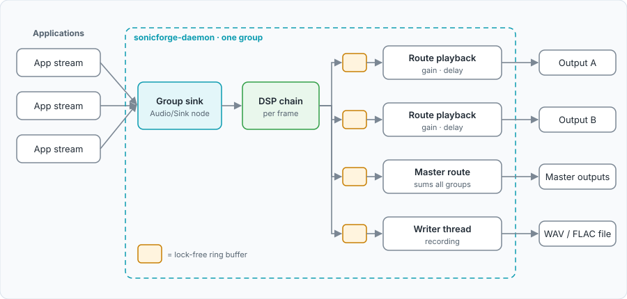

# Audio Engine

The engine lives in `daemon/src/pw.rs`. It connects to PipeWire, tracks
application streams and output devices, and owns the nodes that make up each
group.

## PipeWire objects

For each group the daemon creates:

| Object | PipeWire identity | Purpose |
|---|---|---|
| Group node | `media.class=Audio/Sink`, `node.name=fonyx.group.<id>` | A PipeWire filter node (`pw_filter`, `daemon/src/filter.rs`). Applications are linked into its `playback_FL`/`playback_FR` ports; it runs the DSP chain and puts the result on `output_FL`/`output_FR`. |
| Route node(s) | `node.name=fonyx.<label>.route.<output or default>` | A small filter node per output route, `<label>` being `group.<id>` or `master`. Applies the route's gain, enable switch and delay, and is linked to the device. |

Every connection between these nodes is a real PipeWire link, so the whole
path runs in one graph cycle and adds no latency of its own.

For each application stream it also creates a passive capture tap
(`fonyx.meter.<stream id>`) that only measures the stream's peak level
for the Inputs tab. The tap is flagged `stream.capture.sink` so desktop
privacy indicators do not report microphone use.

Group sinks show up in `wpctl status` as ordinary selectable sinks.

## Audio format

Group and route nodes have mono 32-bit float DSP ports, one per channel (FL,
FR), at the graph's own rate. Filters and dynamics take that rate from each
cycle. Smoothers, delay lines, plugins and the spectrum assume 48 kHz, so on
a graph running at another rate their times scale slightly (a `ponytail:`
note in `pw.rs` marks this). Meter taps are fixed at 48 kHz, stereo, F32LE.

## Stream discovery

The engine listens to the PipeWire registry. A node is treated as an
application stream when it is an audio output stream that is not one of the
daemon's own. For each one the engine records:

- its name and a stable app identity (`identity::app_identity`)
- a service name extracted from `media.name` where the application sets one
  (for example a browser tab's site)
- whether the node is currently `RUNNING`, tracked through a node proxy
- a live peak level from its meter tap

Ports and links are tracked as separate registry globals. PipeWire announces
a node before its ports, so a route requested the moment a stream appears
may find no ports yet. Such routes are kept as pending and retried when a
port arrives for that node.

## Routing a stream into a group

`RouteStreamToGroup` does three things on the engine thread:

1. **Severs existing playback links.** Any link from the stream into an
   output device or another group is destroyed. Links into listeners (meter
   taps, recorders, another mixer's meters) are left alone.
2. **Links the stream's ports into the group sink**, port by port, matched
   by channel label (`FL` to `FL`, `FR` to `FR`). Node-to-node linking was
   tried and rejected: PipeWire attempted to create new ports and failed
   with "no more port available".
3. **Records the assignment** so it can be redone. Some applications replace
   their ports on pause/resume without recreating the node; when a new port
   appears on an already-routed stream, the route is applied again.

If the session manager later links a routed stream straight back to hardware,
the engine sees the new link and removes it.

The first few attempts wait for a full stereo port set on both sides, to
avoid pairing a lone early port with the wrong channel. After five attempts
(`MAX_STRICT_ROUTE_ATTEMPTS`) a single port is accepted, so a genuinely mono
source is still routed.

### Left / right isolate

A stream can be forced to one side with `SetStreamSide`. Every port of the
stream is then linked into that one channel of the group sink instead of its
own. The setting is held in memory for the life of the stream.

### Removing a stream from a group

`UnrouteStream` moves the stream back into the Default group. It does not
reconnect it to hardware: every stream is meant to stay inside the mixer.
Reconnecting to hardware happens only when the daemon shuts down.

### Default routing

A stream that has no assignment is routed into the Default group. On daemon
restart PipeWire replays every live stream; those already listed under a
group are returned to that group rather than swept into Default.

When a manual move is made, it also becomes the app's preferred group in its
profile, so a browser that opens a new stream on each play lands in the same
group.

## Group signal path



```text
app stream ─▶ fonyx.group.<id> ─▶ fonyx.group.<id>.route.<out> ─▶ device
                     │
                     └──────────▶ fonyx.master.route.<out> ─▶ device
```

`Engine::reconcile_links` owns every link out of the daemon's own nodes. It
recomputes the wanted set from the groups and routes (group to each of its
routes, route to its target, every Master member to each Master route) and
runs after every route change and whenever a port or link appears or a link
disappears, because PipeWire announces ports and links after their node.
Links out of the daemon's nodes into a device or another daemon node that are
no longer wanted are cut; anything else listening (a recorder, a link made
by hand with `pw-link`) is left alone. Ports are paired by channel; a device
with no FL/FR ports (a mono device) gets both channels into its first port.

### Before: a ring buffer

Until this design, a group was a capture stream and a playback stream per
route, not linked in the graph and joined by `rtrb` ring buffers. The
playback side needed an 85 ms cushion (the old Settings "buffer size"), a
re-arm watermark and a capture-liveness check, and still underran; the
history is in [Testing](testing.md#ring-buffer-underruns). Measured in the
isolated session with a tone burst, an application's output reached the
device 128 ms later through the old engine and 43 ms later with Fonyx
bypassed (PipeWire's own scheduling), so the old engine added about 85 ms;
through the filter nodes it is 43 ms, nothing added. The
underrun count in `GetMetrics` counted that ring starving and now stays 0.

## Outputs

### Discovery and identity

Sinks and their parent devices are discovered from the registry. Each output
gets a stable id built from the most durable property available: device
serial, then Bluetooth address, then USB/PCI vendor, product and card, then
a name-based fallback. Routes are stored against this id, so they survive a
device being unplugged and reconnected.

Each output is classified (headphones, speaker, Bluetooth, USB, HDMI,
DisplayPort, virtual, other) and given an estimated latency when PipeWire
reports one.

### Output routes

A group's `output_routes` list holds one entry per device with gain, enable,
sync mode and manual delay. The engine reconciles live route nodes against
that list whenever it changes or a device comes or goes. A route
whose device is absent keeps its configuration and is recreated when the
device returns.

A group with no explicit routes behaves as follows:

| Situation | Where the group plays |
|---|---|
| No Master routes, no preferred output | One implicit route to the session manager's default sink, followed when it changes |
| A preferred output is set and available | That device |
| A preferred output is set but unavailable | Chosen by policy: headphones, then speakers, then the system default, then anything available |
| Master has routes | Through the Master bus only |
| The group feeds another group | Into that group's sink |
| It is the Cue group | The cue outputs only; silent if none are set |

If no hardware sink remains and the session manager makes one of the
daemon's own sinks the system default, the engine does not follow it there.
That case produced a feedback loop in practice.

### Delay compensation

Each route has a delay line (`dsp::delay`), pre-allocated for up to 500 ms.
Its sync mode decides the delay applied:

| Mode | Delay |
|---|---|
| Off | None |
| Manual | The configured value, clamped to the maximum compensation |
| Automatic | The largest known latency among the group's automatic routes, minus this output's own. Zero if this output's latency is unknown. |

Delay changes are slewed and read with linear interpolation rather than
applied instantly. The maximum compensation defaults to 150 ms.

### Master and Cue

There is no Master node. Every group except sub-groups and the Cue group is
linked into each Master route node, and PipeWire sums the links at its input
ports.

While the Cue group is audible, routes onto cue outputs from Master and from
other groups are lowered to `cue_duck_level` (default 0.2). Other outputs
are unaffected.

## Timers and events on the engine thread

| Trigger | Action |
|---|---|
| Every 20 ms | Evaluate ducking rules against groups' input peaks |
| Every 2 s | Send the systemd watchdog ping |
| Stream, device or scene event | Evaluate rules |
| Stream appears | Apply its profile, pending scene assignment, or default routing |
| SIGTERM / SIGINT | Reconnect routed streams to hardware, then quit |

## Known limitations

- **Master fader ramp.** Every group's callback advances the shared master
  gain ramp once per frame, so with several active groups it converges
  faster than its nominal 15 ms. It stays smooth.
- **Fake test apps can stall the graph.** The isolated test session's fake
  applications are null-sink nodes, which can be chosen as the graph's
  driver. When one is, moving that group's output to another device left the
  path silent. Real applications are never drivers. `ui/tests/run-isolated.sh`
  keeps them because the endpoint tests need streams to exist.
- **No xrun count.** The underrun figure is always 0 now; PipeWire's own
  xrun count would need a profiler listener.
- **Stream meters** require a full stereo port set; a mono-only stream gets
  no meter.
- **Per-site memory waits for the title.** Moving a browser tab remembers
  its site's group (`AppProfile::site_groups`), but a new tab's site is
  only known once its title arrives, so it plays in the app's group for
  that moment first.
- **Brief locks on the realtime path.** The plugin chain, recordings and
  route delay lines are behind a mutex that the audio callback takes each
  buffer. Contention is limited to moments when the control thread is
  changing them.
